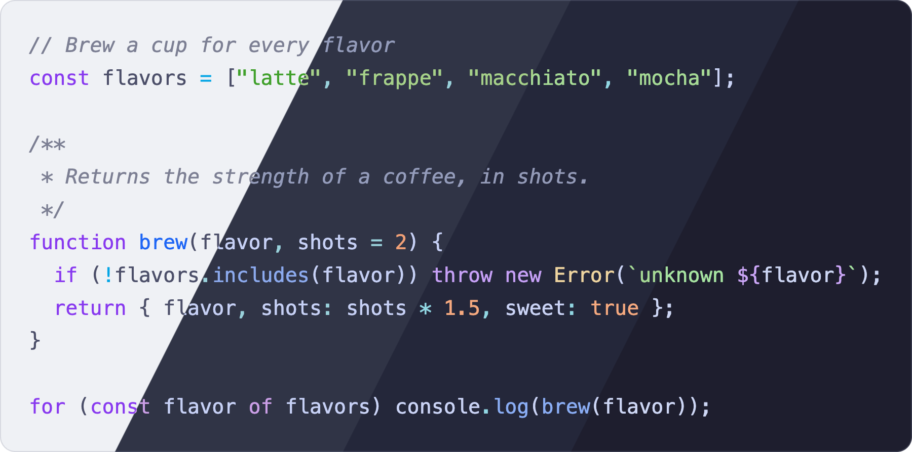
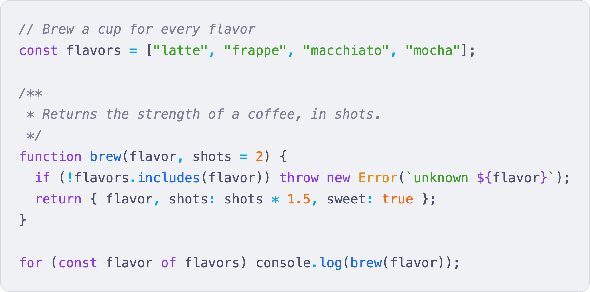
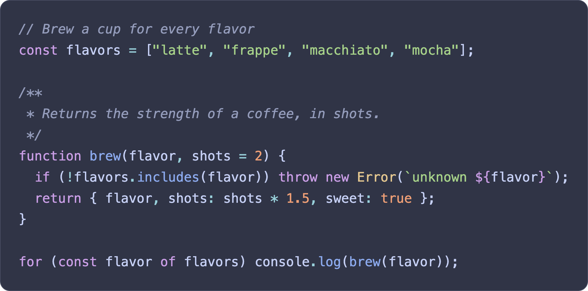
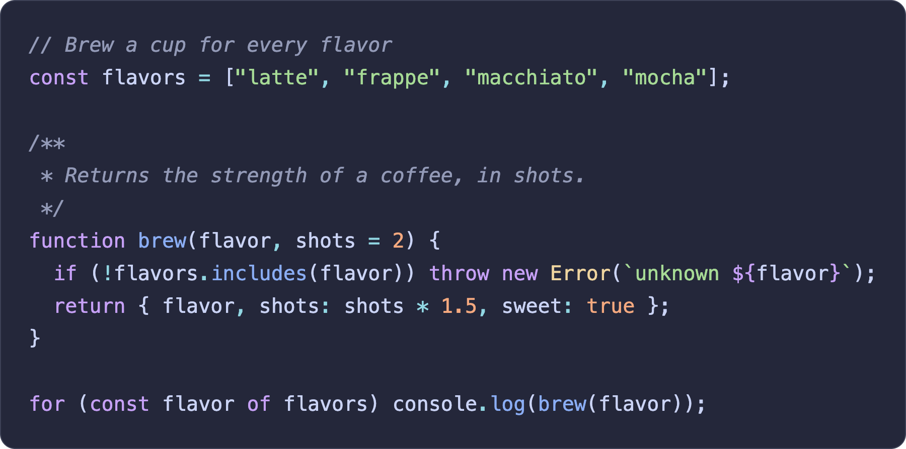
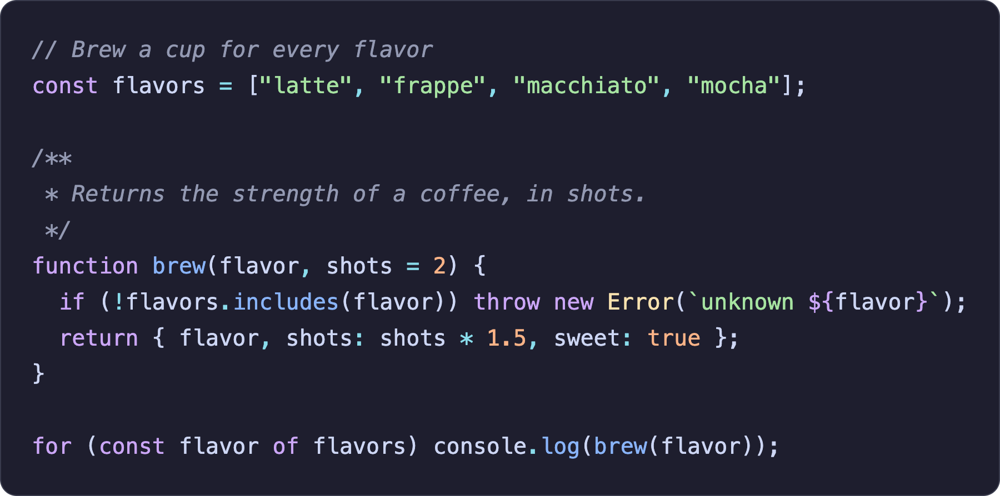

<h3 align="center">
	<br/>
	
	Catppuccin for <a href="https://github.com/speed-highlight/core">Speed Highlight</a>
	
</h3>

<p align="center">
	<a href="https://github.com/matubu/speed-highlight/stargazers"></a>
	<a href="https://github.com/matubu/speed-highlight/issues"></a>
	<a href="https://github.com/matubu/speed-highlight/contributors"></a>
</p>

<p align="center">
	
</p>

## Previews

<details>
<summary>🌻 Latte</summary>

</details>
<details>
<summary>🪴 Frappé</summary>

</details>
<details>
<summary>🌺 Macchiato</summary>

</details>
<details>
<summary>🌿 Mocha</summary>

</details>

## Usage

Catppuccin is now [included in Speed Highlight](https://github.com/speed-highlight/core/tree/main/src/themes): the four flavors ship in the `@speed-highlight/core` package as `catppuccin-latte.css`, `catppuccin-frappe.css`, `catppuccin-macchiato.css` and `catppuccin-mocha.css`.

1. Install the package.

   ```sh
   npm i @speed-highlight/core
   ```

2. Import the stylesheet of your preferred flavor.

   ```js
   import '@speed-highlight/core/themes/catppuccin-mocha.css'; // or latte, frappe, macchiato
   ```

3. Mark your code blocks with a `shj-lang-*` class and call `highlightAll()`.

   ```html
   <div class="shj-lang-js">console.log('hello')</div>

   <script type="module">
   	import { highlightAll } from '@speed-highlight/core';
   	highlightAll();
   </script>
   ```

To render a string instead of a page element (React, Vue, Svelte, ...), use `highlightHTML(code, lang)` and put its output inside an element with the `shj-lang-<lang>` class, as shown in the [Speed Highlight README](https://github.com/speed-highlight/core#readme).

## 🙋 FAQ

- Q: **_"How can I follow the system light/dark setting?"_**\
  A: Load two flavors and let the browser pick one with a media query:

  ```html
  <link rel="stylesheet" media="(prefers-color-scheme: light)" href="node_modules/@speed-highlight/core/dist/themes/catppuccin-latte.css">
  <link rel="stylesheet" media="(prefers-color-scheme: dark)" href="node_modules/@speed-highlight/core/dist/themes/catppuccin-mocha.css">
  ```

## 💝 Thanks to

- [Mathias](https://github.com/matubu)

&nbsp;

<p align="center">
	
</p>

<p align="center">
	Copyright &copy; 2021-present <a href="https://github.com/catppuccin" target="_blank">Catppuccin Org</a>
</p>

<p align="center">
	<a href="https://github.com/catppuccin/catppuccin/blob/main/LICENSE"></a>
</p>
